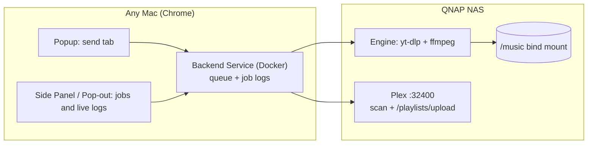

Status: needs-triage

# Spec v2 — Browser Extension + NAS Backend (deprecating the desktop app)

## Problem Statement

The Tauri desktop app was hard to deploy to a second Mac (bundle identity, per-machine config, SMB mount quirks, the app has to be open). The extension was the part people actually used. While testing it we also found:

- **The popup loses all state when it closes.** Chrome destroys the popup page as soon as it loses focus. The job keeps running in the app, but reopening the popup shows nothing because:
  1. the popup doesn't remember which job it started, and
  2. the Bridge only keeps the *latest* output line per job (`Job.progress`), so there's no log to catch up on.

## Solution

Two parts:

1. **Backend Service**: a headless Rust HTTP service in a Docker container on the QNAP NAS (next to Plex). It owns the Engine (yt-dlp + ffmpeg), the job queue, per-job logs, `.m3u` generation and the Plex import. It writes to the Music share as a local disk, so we no longer deal with SMB or NFD/NFC accent problems.
2. **Browser Extension**: the only client. Each machine's extension points at `http://10.0.0.69:<port>` with a shared token.
   - **Popup**: stays the quick "send this tab" action.
   - **Side Panel** (new, `chrome.sidePanel`): stays open while you browse. Shows the job queue, history and a live log for each job.
   - **Pop-out window**: the same page opened with `chrome.windows.create({ type: "popup" })` for people who want a floating window.

The desktop app is frozen. It gets no new features and is removed once v2 is in use on both machines.

## User Stories

1. As a user on any Mac, I install only the extension and paste the server URL and token once. I don't have to install a desktop app.
2. As a user, I can send a song, album or playlist and close the popup right away. The download keeps going.
3. As a user, I can open the Side Panel at any time and see what's running, what's queued and what finished, with the full log.
4. As a user, if I open the panel partway through a job, I see the log from the beginning and then live updates. Nothing is lost.
5. As a user, I can pop the panel out into its own small window.
6. As a user, I can send several links in a row. They queue and run one at a time.
7. As a user, I can cancel a queued or running job.
8. As the maintainer, I can deploy and update with `docker compose pull && docker compose up -d` in QNAP Container Station.
9. As the maintainer, the Engine keeps itself up to date without rebuilding the image.

## Implementation Decisions

### Backend Service (`server/` crate)
- **Reuse, don't rewrite.** Move `extractor.rs`, `plex.rs`, `config.rs` and the job model from `bridge.rs` into a new standalone `server/` crate with no Tauri dependency. Everything that was behind the `BridgeHost` trait becomes plain server state. `src-tauri/` stays as it is until it's deleted.
- **Config via env vars** (12-factor, Docker-friendly). Each one replaces a `config.json` field:
  | Env | Example | Notes |
  |---|---|---|
  | `BRIDGE_TOKEN` | *(secret)* | Required. The server refuses to start without it. |
  | `PLEX_URL` | `http://10.0.0.69:32400` | Normalized with `normalize_plex_url`. |
  | `PLEX_TOKEN` | *(secret)* | Optional. Without it, the Plex step is skipped. |
  | `PLEX_SECTION_ID` | `3` | |
  | `MUSIC_ROOT` | `/music` | Path inside the container. |
  | `PLEX_MUSIC_ROOT` | `/share/CACHEDEV1_DATA/Multimedia/Media/Music` | Prefix rewrite for `.m3u` paths. Same mechanism as today, but `MUSIC_ROOT` replaces the Mac path. |
  | `PLAYLISTS_DIR` | `/music/Playlists` | |
  | `DATA_DIR` | `/data` | Engine binary and job history. |
- **Binding:** `0.0.0.0:47821` on the LAN. Token auth on every route except `/health`. CORS limited to `chrome-extension://` origins, as today. Never expose this port to the internet.
- **Job queue:** FIFO with a single worker (the Engine Lock stays the serialization point). Job states: `queued → running → succeeded | failed | cancelled`.
- **Job Log:** every Engine line is appended to that job's log with a sequence number. Each job keeps at most 2,000 lines (ring buffer). History of the last 50 jobs is saved to `DATA_DIR/jobs.json`, so a container restart doesn't wipe it. Jobs that were running during a restart are marked `failed (interrupted)`.
- **Live updates use cursor polling, not SSE/WebSockets.** `EventSource` can't send the `X-Bridge-Token` header, and putting the token in a query string leaks it into logs. Polling `GET /jobs/{id}/log?since=<seq>` once a second is simple and resumable. It's also how "open the panel mid-job and catch up" works.
- **API:**
  | Method | Path | Purpose |
  |---|---|---|
  | GET | `/health` | Engine ready/version (no auth) |
  | POST | `/jobs` | Submit `{ url, mode: "song" \| "playlist" }` → `{ id }` |
  | GET | `/jobs` | List recent jobs (summary, newest first) |
  | GET | `/jobs/{id}` | Job detail (status, message, track counts) |
  | GET | `/jobs/{id}/log?since=N` | Log lines with `seq > N` plus `next` cursor and `done` flag |
  | POST | `/jobs/{id}/cancel` | Cancel a queued job, or kill the running Engine process |
  - The existing `/extract` and `/jobs/{id}` stay as aliases until the extension is updated.
- **Engine:** the standalone `yt-dlp_linux` binary goes in `DATA_DIR`. It's downloaded on first start, then updated at startup and every 24h with `yt-dlp -U` while holding the Engine Lock. ffmpeg comes from the image.
- **SMB workarounds removed:** `--paths temp:` and `--no-part` were only there for the macOS SMB mount. Downloading in place on the NAS is fine. The temp dir becomes `DATA_DIR/tmp`, or yt-dlp's default.

### Docker / QNAP
- Multi-stage `Dockerfile`: a Rust builder, then a `debian:bookworm-slim` runtime with `ffmpeg`, `ca-certificates` and `python3`. The runtime runs as a non-root user whose UID/GID (`PUID`/`PGID`) match the owner of the share, so files show up with the right permissions in Plex and over SMB.
- `docker-compose.yml` with bind mounts `/share/CACHEDEV1_DATA/Multimedia/Media/Music:/music` and `./data:/data`, port `47821:47821`, `restart: unless-stopped`, and secrets read from a `.env` file that is never committed (`.env.example` is committed).
- Images are built for `linux/amd64` and `linux/arm64` with `docker buildx`, and published to GHCR from GitHub Actions on tag.

### Extension
- **Settings:** server URL and token. On save, request the origin at runtime via `optional_host_permissions: ["http://*/*", "https://*/*"]` + `chrome.permissions.request`, so we don't need a broad install-time permission. Includes a "Test connection" button that calls `/health` and then an authed `/jobs`.
- **Popup:** detect the link type and pick song vs playlist as today, then `POST /jobs`. Shows "Queued ✓" with "Open panel" and "Pop out" buttons. It doesn't poll anymore.
- **Side Panel (`sidepanel.html`):** a job list (status, title, progress bar) and an expandable live log for the selected job. It polls `/jobs` every 2s and the selected job's log every 1s with the cursor. Polling stops when the panel is hidden (`visibilitychange`).
- **Pop-out:** opens `sidepanel.html?popout=1` in a 420×640 popup window. If one is already open, it's focused instead of opening a second.
- **Badge:** the background service worker shows the number of active jobs on the action badge using a `chrome.alarms` poll (≥30s; MV3 limit), so you know something is running even with the panel closed.
- Shared code (`api.js`) for fetch + auth + error handling, used by the popup, side panel and options page.

## Testing Decisions
- **Server:** keep and port the existing `bridge.rs` tests (auth, CORS, URL validation, job lifecycle with a fake Engine). Add tests for the queue order, the log cursor (`since` semantics, ring buffer truncation), cancel (queued and running), history persistence and restart recovery.
- **Plex:** keep the pure-function tests (`mac_to_plex_path`, M3U generation, URL normalization).
- **Docker:** a smoke test in CI that builds the image, runs it with a fake token, and checks that `/health` returns 200 and that `yt-dlp --version` and `ffmpeg -version` work inside it.
- **Extension:** manual checklist (load unpacked, submit, close popup, open panel mid-job and confirm the log catches up, pop out, cancel).

## Out of Scope
- Exposing the service outside the LAN, or multi-user accounts.
- Firefox/Safari extensions.
- A web UI served by the backend. (Cheap to add later: the side panel page could be served as-is.)
- Push notifications on completion. (Possible follow-up using `chrome.notifications` from the badge poll.)

## Open Questions (triage)
1. **QNAP CPU architecture:** x86_64 or ARM? This decides whether we need the arm64 build at all. Check with `uname -m` over SSH, or look at the model in Container Station.
2. **Share ownership:** which user/UID owns `Multimedia/Media/Music` (for `PUID`/`PGID`)?
3. **Plex scan:** today we refresh the whole section. Should we switch to a partial scan (`/library/sections/3/refresh?path=<album dir>`)? It's much faster for big libraries.
4. **Cookies:** some age-restricted or members-only videos need cookies. Is that out of scope as before, or should we support an optional `cookies.txt` volume?
